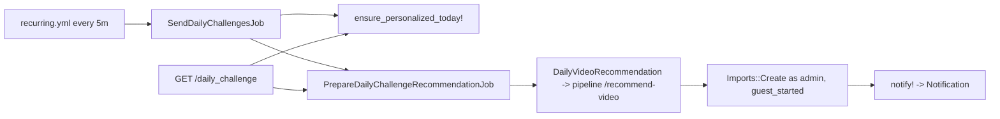

# Lesson 2026-10-22 — Daily Langlets: from scheduler tick to a ready video card

**Why this flow:** it is the most-changed flow in the last 30 days (`daily_video_recommendation.rb`, the prepare job, `daily_challenges/show.html.erb`, 5 commits each) and it is not in the learning log yet. Delivery is currently paused in production (commit `5b8c96a`), so it is a good time to understand what is paused.

## 🎯 Today's flow: Daily Langlets personalized recommendation (day 6+)
- **Why it matters:** after a learner finishes the five curated starter quests, the platform picks one video per local day, tailored to their saved words and completed lessons, pre-builds the course for it, and then notifies them. Triggers: a Solid Queue recurring job every 5 minutes, and the learner opening `/daily_challenge`.

## 🗺️ Step by step
1. `config/recurring.yml` runs `SendDailyChallengesJob` every 5 minutes (production).
2. `SendDailyChallengesJob#perform` returns early unless `DailyChallenge.delivery_enabled?` (the pause switch).
3. It re-enqueues unsent `daily_challenge` notifications, then for each `StarterChallenge` whose `next_practice_at` is within 30 min calls `DailyChallenge.ensure_personalized_today!`, which creates today's row (unique `(starter_challenge_id, day)`) and advances `next_practice_at` to tomorrow.
4. `DailyChallenge.due` rows get `notify!`; `recommendations_to_prepare` rows get `PrepareDailyChallengeRecommendationJob`.
5. The prepare job claims the row under `with_lock` (state → `searching`, 10-min lease, max 3 attempts).
6. Outside the lock: `DailyVideoRecommendation.call` builds a bounded context (vocab, completed lessons, imports, history), calls `PipelineClient.recommend_video` (Gemini + Google Search on the pipeline host), then validates URL, exclusions, content type, preflight, channel.
7. The result is saved in `recommended_video` (JSON), state → `importing`.
8. `prepare_course` imports the video as the admin user in `guest_started` mode (no credits, no enrollment), keeps `source_import_request_id`.
9. When the source import is ready, the course is published and the translation is ready, state → `ready` and `quest.notify!` creates the notification.
10. `DailyChallengesController#show` also calls `ensure_personalized_today!` and enqueues preparation if the card is not ready yet, so opening the page can start work too.



## 💻 Key snippets
**`app/jobs/send_daily_challenges_job.rb:4`**
```ruby
return unless DailyChallenge.delivery_enabled?
Notification.where(kind: :daily_challenge, sent_at: nil).find_each do |notification|
  DeliverNotificationJob.perform_later(notification.id)
end
StarterChallenge.where(next_practice_at: ..(Time.zone.now + DailyChallenge::PREPARATION_LEAD)).find_each do |challenge|
  DailyChallenge.ensure_personalized_today!(challenge)
end
```
Notice: the scheduler is self-healing; it re-enqueues lost work every tick instead of relying on a single enqueue.

**`app/jobs/prepare_daily_challenge_recommendation_job.rb:7`** (claim pattern)
```ruby
claimed = quest.with_lock do
  return if quest.notification_id.present? || quest.skipped_at.present? || quest.recommendation_state.in?(%w[ready failed])
  ...
  return if quest.search_started_at && quest.search_started_at > Time.zone.now - DailyChallenge::SEARCH_LEASE
  ...
  quest.update!(recommendation_state: "searching", search_started_at: Time.zone.now,
    search_attempts: quest.search_attempts + 1)
  :search
end
```
Notice: the lock only covers the state transition; the slow Gemini and provider calls happen after it returns, using a time-based lease to stop duplicate workers and let abandoned jobs resume.

**`app/services/daily_video_recommendation.rb:121`** (content rotation)
```ruby
previous_type = previous_videos.first&.fetch("content_type", nil)
index = CONTENT_TYPES.index(previous_type)
day = @user.starter_challenge&.active_day || 6
CONTENT_TYPES[index ? (index + 1) % CONTENT_TYPES.length : (day - 6) % CONTENT_TYPES.length]
```
Notice: the next type follows the last card's actual type; legacy cards without a type fall back to a day-based rotation. It is only a preference (`variety_is_optional: true`).

**`app/models/starter_challenge.rb:30`**
```ruby
def active_day = (local_today - first_challenge_on).to_i + 1
def practice_started? = active_day > 5
```
Notice: "which day is it" is computed from the learner's timezone, not stored; this is why missed days are skipped rather than backfilled.

**`app/models/daily_challenge.rb:74`** (`notify!`)
```ruby
if starter_challenge.daily_challenges.where("day > ?", day).where(available_at: ..Time.zone.now).exists?
  update!(skipped_at: Time.zone.now)
else
  update!(notification: Notifications.deliver(...))
end
```
Notice: after an outage only the latest unlocked quest is sent; older ones are marked skipped.

## 🆕 What changed recently
- `255c065` (10-09): prioritize saved vocabulary, completed lessons and dialect (Palestinian spoken Arabic) in the context.
- `443b8e1` (10-13): bilingual descriptions stored in `recommended_video.descriptions`.
- `2521cc3` (10-16): `Imports::Create` reuses stored metadata for a ready prepared card, so the Import click does not repeat provider checks.
- `5b8c96a` (10-17): production delivery paused via `config.x.daily_langlets_delivery_enabled = false`. Opening the page can still prepare a recommendation.

## ✨ Did you know?
- The user-facing name is "Daily Langlets", but the internals still say `daily_challenge`, deliberately, to keep routes and names stable (per `docs/architecture.md`).
- The learner never imports from the recommender's own account: the course is pre-built under `User::ADMIN_EMAIL` and then adopted into the learner's channel.
- There is a separate pipeline deployment step: `docs/architecture.md` says to deploy the pipeline before Rails when the context shape changes.

## 🧠 Quiz (answers not revealed)
1. (MC) What stops two workers from running Gemini for the same daily card at once? a) a unique DB index on `recommended_video` b) a row lock plus a 10-minute `search_started_at` lease c) a Redis mutex d) Solid Queue concurrency keys
2. (MC) With `delivery_enabled?` false, which of these still happens? a) the 5-minute scheduler prepares recommendations b) opening `/daily_challenge` can still enqueue preparation c) `notify!` creates notifications d) nothing at all
3. (What if) The server is down for two days and comes back. Learner has days 6, 7, 8 rows unlocked. Which get notified, and what happens to the others?
4. (Find it) Which file/method decides which language a personalized day uses, and what rule does it apply?
5. (Open) How would you add a fifth content type, e.g. "news"? List the places you would touch.
